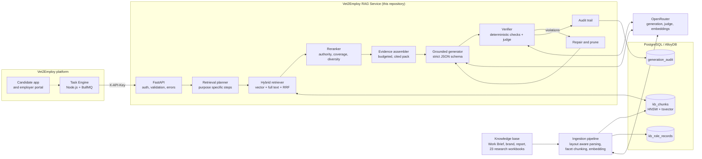
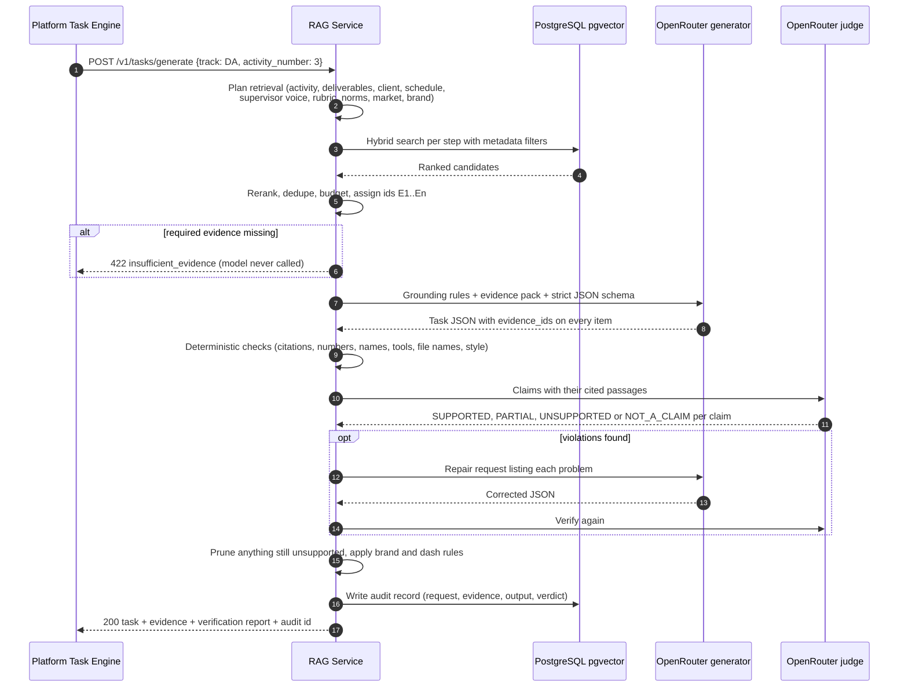
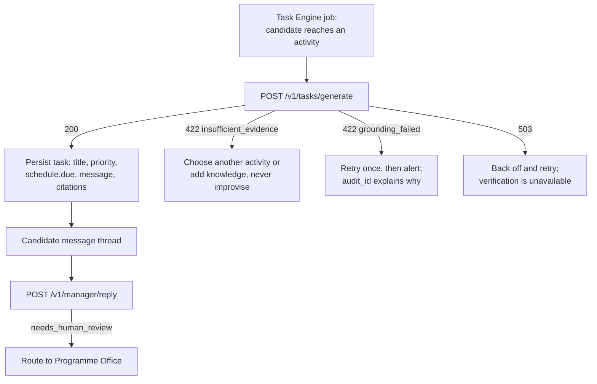

# Vet2Employ RAG Service

**Grounded retrieval augmented generation for the Vet2Employ AI Manager.**

This service gives the Vet2Employ simulated working environment a realistic, evidence based work culture. It turns the Programme Work Brief, the brand guidelines and 521 researched UK job roles into a governed knowledge base, then lets the AI Manager (running on OpenRouter) issue tasks and reply to candidates **only from that evidence**. Every claim carries a citation, every response is verified before it leaves the service, and when the evidence cannot support a request the service abstains instead of guessing.

Built by Phexara Limited for the Vet2Employ platform.

<p>


</p>

## Contents

1. [Why this service exists](#why-this-service-exists)
2. [What it does](#what-it-does)
3. [System architecture](#system-architecture)
4. [How a task is generated](#how-a-task-is-generated)
5. [Hallucination control](#hallucination-control)
6. [The knowledge base](#the-knowledge-base)
7. [Quick start](#quick-start)
8. [Integrating with the platform](#integrating-with-the-platform)
9. [API at a glance](#api-at-a-glance)
10. [Configuration](#configuration)
11. [Quality and evaluation](#quality-and-evaluation)
12. [Operations and security](#operations-and-security)
13. [Project structure](#project-structure)
14. [Decisions for the product owner](#decisions-for-the-product-owner)
15. [Further documentation](#further-documentation)

## Why this service exists

The Plain English Report states the quality bar plainly: the realism of the simulation is the entire product, and the AI Manager must behave the way a real manager in that role would. A language model on its own cannot meet that bar. It invents colleagues, deadlines, tools and file names, and every invented detail breaks the realism and undermines the evidence a Verified Profile is built on.

This service closes that gap. It keeps the AI Manager inside the facts the programme has defined (clients, activities, deliverables, due points, rubrics, naming rules) and enriches them with what real UK employers actually expect from each role (responsibilities, tools, team structures, culture). Nothing is generated from memory.

## What it does

| Capability | Endpoint | Outcome |
| :--- | :--- | :--- |
| Issue a work item | `POST /v1/tasks/generate` | A structured, cited task from the AI Manager: message, objectives, ordered steps, deliverables with exact file names and due points, tools, collaboration, competencies and schedule. |
| Reply in character | `POST /v1/manager/reply` | An in character reply to a candidate that answers only from evidence, abstains politely when it cannot, and flags wellbeing or fairness concerns for human review. |
| Ground existing prompts | `POST /v1/retrieve` | Cited evidence plus a ready made grounding prompt for any OpenRouter call the platform already makes. |
| Verify any output | `POST /v1/verify` | A claim by claim verification report for text produced anywhere, checked against knowledge base passages. |
| Calibrate simulated companies | `GET /v1/insights/role_profile` | Exact, model free statistics: the most common skills and tools for a role, level and sector, and employee culture ratings. |
| Discover valid values | `GET /v1/catalog` | Tracks, role families, sectors, levels, task types and knowledge base coverage. |

Four task types are supported, matching the Work Brief's description of a realistic week: `core_activity`, `colleague_request`, `stakeholder_update` and `complication` (one of the deliberate complications the brief already describes, never a new invented problem).

## System architecture



**Design principles**

* **Evidence first.** The model sees only a numbered evidence pack and must cite it. Authority is explicit: the Programme Work Brief always overrides market evidence.
* **Planned retrieval, not one search.** A realistic task needs an activity definition, a deliverable, a due point, client context, a supervisor's voice, real employer practice and brand rules. The planner retrieves each with its own query and filters, so nothing important is left to chance.
* **Verify, repair, prune, or refuse.** Output is never trusted on the model's word. Unsupported content is repaired once, then removed; if core content is unsupported the response is refused and audited.
* **Same database as the platform.** pgvector on PostgreSQL matches the existing AlloyDB stack and the `vector(1536)` embeddings already used for artefacts.
* **Provider agnostic through OpenRouter.** Model choice, fallbacks and privacy routing are configuration, not code.

## How a task is generated



A typical response contains the task, the evidence list with human readable citations (for example `Vet2Employ Week One Work Brief, Data Analyst > 7. Track 1: Data Analyst > 7.7 Required deliverables, pages 31 to 32`), and a verification block such as:

```json
{
  "verdict": "approved",
  "groundedness": 1.0,
  "claims_total": 18,
  "claims_factual": 16,
  "claims_supported": 16,
  "violations": [],
  "pruned": [],
  "checks_run": ["citations", "numbers", "entities", "tools", "file_names", "style", "entailment"],
  "repair_attempts": 0
}
```

## Hallucination control

Seven independent layers sit between the model and the candidate. Each one catches a different failure.

| Layer | What it enforces | How |
| :--- | :--- | :--- |
| 1. Abstention gate | No generation without the evidence a request needs | Required retrieval steps (for example the activity definition) must return evidence or the service returns `insufficient_evidence` before any model call. |
| 2. Constrained generation | The model may only restate evidence | Explicit grounding rules, an authority order, a numbered evidence pack, and a strict JSON schema in which every factual item carries `evidence_ids`. |
| 3. Citation integrity | Every claim points at real evidence | Unknown or missing evidence ids are rejected. |
| 4. Deterministic fact checks | No invented numbers, names, tools or files | Numbers and times must appear in the cited passages; capitalised names must exist in the evidence; tools are fuzzy matched against cited passages; `V2E_` file names must match the brief exactly. |
| 5. Entailment judge | Meaning is supported, not just words | An independent model on OpenRouter labels each claim against only its cited passages. If the judge is unavailable the request fails closed with `503`. |
| 6. Repair, prune or refuse | Unsupported content never reaches a candidate | One targeted repair round, then removal of any remaining unsupported optional item. Unsupported core content (summary, objectives, steps) or excessive pruning causes a refusal. |
| 7. Brand and style rules | The voice the brand defines | Banned vocabulary from the Brand Strategy style sheet (with technical exceptions such as TLS certificates), no em or en dashes, and no breaking character. |

Every decision is written to `generation_audit` with the prompt version, the evidence ids and the verification report, so any output can be traced back to the exact passages that justified it.

## The knowledge base

All material supplied for this project is ingested. Files live in `knowledge_base/raw/` and are described by `config/knowledge_manifest.yaml`.

| Source | Role in the system | Authority |
| :--- | :--- | :--- |
| Vet2Employ Week One Work Brief | The rules of the simulation: four tracks, fictitious clients, 12 sequential activities per track, deliverables, due points, rubrics, weekly rhythm, communication norms | Highest |
| Vet2Mploy Brand Strategy Portfolio | Voice and tone, the AI Manager persona guidance, the word and phrase style sheet | High |
| Vet2Mploy Plain English Report | What the platform is and how candidates experience it | High |
| 23 labour market research workbooks | 521 UK job roles across Cybersecurity, Data Analyst, Data Engineer and Software Developer in Construction, Consulting, Education, Healthcare, IT and the general market: responsibilities, skills, tools, team structures, collaboration, Indeed ratings, employee reviews | Market evidence |
| VEEP Knowledge Graph Design (GCP) | Engineering reference, excluded from task generation by default | Reference |

**Ingestion result on the supplied files:** 27 files, 0 failures, 3,194 chunks, 521 role records. All 12 activities of all four tracks are detected and tagged, and deliverable file names such as `V2E_DA_[Surname]_D2_DataQualityLog_v1.xlsx` survive parsing intact.

**How the material is processed**

* **Layout aware parsing.** PDFs are read with table extraction and font aware heading detection, so deliverable tables stay tables and every passage knows its section path and page. Running headers and footers are removed automatically.
* **Track tagging.** Every passage inside a track section of the Work Brief is tagged with its track (DA, SE, CY, DE), its facet (activity, deliverables, client, rubric, supervisor voice and so on) and, for activities, its activity number.
* **Facet chunking for job roles.** Each researched role becomes separate passages for responsibilities, skills, tools, team collaboration, culture and ratings, so a question about tooling retrieves tooling evidence.
* **Normalisation.** Header variants, sheet name variants and level labels (`Mid-level`, `Mid-Level`, `Beginner `) are unified. Topic sheets are merged into Master records by Company ID and job title, with an employer name fallback that repairs mistyped IDs.
* **Idempotent updates.** Unchanged files are skipped by content hash; changed files are replaced atomically; embeddings are cached by content hash so unchanged text is never paid for twice.

A data quality report is written on every run to `var/reports/ingestion_report.md`. See [docs/knowledge_base.md](docs/knowledge_base.md) for the findings and for how to add new material.

## Quick start

### Option A: Docker (recommended)

```bash
cp .env.example .env              # set OPENROUTER_API_KEY and V2E_API_KEYS
docker compose up -d db api       # PostgreSQL 16 with pgvector, then the API (migrations run automatically)
docker compose run --rm ingest    # parse, embed and load the knowledge base
curl localhost:8000/health/ready  # "ready" once the knowledge base is loaded
```

Interactive API documentation is served at `http://localhost:8000/docs`.

### Option B: Local Python

```bash
python3 -m venv .venv && source .venv/bin/activate
make install                      # pip install -e ".[dev]"
cp .env.example .env              # set OPENROUTER_API_KEY and V2E_DATABASE_URL
make db-up                        # or point V2E_DATABASE_URL at any PostgreSQL with pgvector
v2e migrate
v2e ingest
v2e serve
```

### Option C: Offline development without keys or a database

```bash
export V2E_VECTOR_BACKEND=memory V2E_EMBEDDING_PROVIDER=hashing V2E_EMBEDDING_DIMENSIONS=384
export V2E_MIN_SEMANTIC_SIMILARITY=0.05   # the stand in embedder scores lower than real models
v2e ingest                        # stored as a snapshot under var/memory_store
v2e search "When is the data quality log due?" --track DA
v2e eval-retrieval
```

The hashing embedder is a lexical stand in for development only; the settings validator refuses it in production.

### Try it

```bash
curl -s -X POST localhost:8000/v1/tasks/generate \
  -H "X-API-Key: $V2E_API_KEY" -H "Content-Type: application/json" \
  -d '{"track": "DA", "activity_number": 3, "job_level": "mid_level", "sector": "consulting",
       "simulation_day": "Monday", "candidate_first_name": "Adaeze"}'
```

## Integrating with the platform

The platform keeps OpenRouter for everything it already does. This service becomes the grounded path for anything the AI Manager says to a candidate.



Integration essentials (full guide with TypeScript examples in [docs/integration_guide.md](docs/integration_guide.md)):

1. **Authenticate** every call with `X-API-Key`. Send `X-Request-ID` to correlate logs.
2. **Pass names, never ask the model to invent them.** Supply `manager_name` and `candidate_first_name` if the persona has a name; otherwise the manager signs off by role.
3. **Store the citations** with the task. They are the evidence trail behind the simulated work and fit the Task and Artefact nodes in the knowledge graph design.
4. **Respect the verdict.** Only `approved` and `approved_with_pruning` responses are returned with `200`. Never fall back to an ungrounded model call on `422` or `503`.
5. **Ground existing prompts** with `/v1/retrieve` and check their output with `/v1/verify` when a flow must stay on direct OpenRouter calls.

## API at a glance

| Method | Path | Purpose | Auth |
| :--- | :--- | :--- | :--- |
| `POST` | `/v1/tasks/generate` | Generate one verified work item | API key |
| `POST` | `/v1/manager/reply` | In character reply to a candidate | API key |
| `POST` | `/v1/retrieve` | Evidence and grounding prompt for external calls | API key |
| `POST` | `/v1/verify` | Verify text against knowledge base chunks | API key |
| `GET` | `/v1/catalog` | Valid values and knowledge base coverage | API key |
| `GET` | `/v1/insights/role_profile` | Deterministic role statistics | API key |
| `POST` | `/v1/admin/ingest` | Background ingestion of the knowledge base directory | Admin key |
| `POST` | `/v1/admin/documents` | Upload and ingest a single file | Admin key |
| `GET` | `/v1/admin/documents` | List ingested documents | Admin key |
| `DELETE` | `/v1/admin/documents/{document_id}` | Remove a document and its chunks | Admin key |
| `GET` | `/health/live`, `/health/ready` | Liveness and readiness | None |
| `GET` | `/metrics` | Prometheus metrics | None |

Error contract: every error returns `{"error": "...", "message": "...", "details": {...}}`. The main codes are `insufficient_evidence` (422), `grounding_failed` (422), `verification_unavailable` (503), `upstream_model_error` (502) and `invalid_model_output` (502). Full schemas in [docs/api_reference.md](docs/api_reference.md).

## Configuration

All settings are environment variables (prefix `V2E_`) or entries in `.env`. The most important are below; `.env.example` lists every option.

| Variable | Default | Purpose |
| :--- | :--- | :--- |
| `OPENROUTER_API_KEY` | none | OpenRouter key for generation, judging and embeddings |
| `V2E_API_KEYS` | none | Comma separated platform keys (required in production) |
| `V2E_GENERATION_MODEL` | `anthropic/claude-sonnet-4.5` | Task and reply generation |
| `V2E_GENERATION_FALLBACK_MODELS` | `openai/gpt-4o` | OpenRouter fallback routing |
| `V2E_VERIFIER_MODEL` | `anthropic/claude-haiku-4.5` | Independent entailment judge |
| `V2E_EMBEDDING_MODEL` | `openai/text-embedding-3-small` | Embeddings through OpenRouter |
| `V2E_EMBEDDING_DIMENSIONS` | `1536` | Must match the model and the database column |
| `V2E_DATABASE_URL` | local PostgreSQL | PostgreSQL or AlloyDB with pgvector |
| `V2E_OPENROUTER_DATA_COLLECTION` | `deny` | Route only to providers that do not retain prompts for training |
| `V2E_VERIFICATION_ENABLE_ENTAILMENT` | `true` | Judge every claim; fail closed if the judge is down |
| `V2E_VERIFICATION_MAX_REPAIR_ATTEMPTS` | `1` | Targeted repair rounds before pruning |
| `V2E_BRAND_NAME` | `Vet2Employ` | Candidate facing product name |

Confirm model availability and pricing on the OpenRouter models page before deployment; every model is configuration only.

## Quality and evaluation

| Suite | Command | Coverage |
| :--- | :--- | :--- |
| Unit tests | `make test` | 86 tests: parsing, chunking, filters, fusion, planning, OpenRouter client contracts, every verification check, pruning, the full generation pipeline with scripted models, the HTTP contract and repository style rules |
| PostgreSQL integration | `make test-integration` | Migrations, dimension guard, filtered HNSW and full text search, atomic replacement, cache and audit |
| Knowledge base integration | `pytest tests/integration/test_knowledge_base.py` | Ingests the real files and asserts track and activity coverage, file names and retrieval quality |
| Retrieval evaluation | `v2e eval-retrieval` | Hit rate, MRR, precision and nDCG on 24 golden questions |
| Generation evaluation | `v2e eval-generation` | 13 end to end scenarios: approval rate, groundedness, abstention and latency |

Offline baseline (lexical stand in embedder, no network): **hit rate at 5 of 1.00 in memory and 0.96 on PostgreSQL, with MRR between 0.74 and 0.78** on the golden set. Run `v2e eval-retrieval` after ingesting with the production embedding model to record the production baseline, and keep it as a regression gate. See [docs/evaluation.md](docs/evaluation.md).

## Operations and security

* **Deployment.** One stateless container (`Dockerfile`) plus PostgreSQL with pgvector. It suits Cloud Run with AlloyDB in the existing GCP footprint, or any container platform.
* **Observability.** Structured JSON logs with request ids; Prometheus metrics for latency, model calls, tokens, verification verdicts, unsupported claims and abstentions.
* **Privacy.** Emails, phone numbers, postcodes, card and account numbers and National Insurance numbers are redacted from candidate messages before they reach a model, matching the data handling rules in section 4.2 of the Work Brief. OpenRouter routing defaults to providers that do not collect data.
* **Access.** Separate platform and admin keys, constant time comparison, upload type and size limits, non root container user.
* **Confidentiality.** Knowledge base files are excluded from version control by `.gitignore`; distribute them through an approved channel.

Runbooks, scaling guidance and audit queries are in [docs/operations.md](docs/operations.md).

## Project structure

```text
vet2employ_rag/
  config/                  tracks, knowledge manifest, brand vocabulary (YAML)
  migrations/              SQL schema (pgvector, HNSW, full text, audit)
  knowledge_base/raw/      source documents and research workbooks
  eval/                    golden retrieval set and generation scenarios
  docs/                    architecture, API, integration, knowledge base, operations, evaluation
  src/v2e_rag/
    api/                   FastAPI app, routes, schemas, security
    domain/                models, controlled vocabularies, config loaders
    ingestion/             PDF, Word and Excel parsing, chunking, pipeline
    embeddings/            OpenRouter embedder, cache, offline embedder
    store/                 pgvector and in memory backends, migrations
    retrieval/             planner, hybrid retriever, reranker, evidence pack
    llm/                   OpenRouter client, prompts, output schemas
    verification/          claims, deterministic checks, entailment judge, verifier
    generation/            generation service, pruning, PII redaction, requests
    insights/              deterministic role profiles
    evaluation/            retrieval and generation evaluation
    observability/         logging and metrics
    cli.py                 the v2e command line
  tests/                   unit, integration and repository style tests
```

## Decisions for the product owner

These points came out of the source material and need a decision; the code makes each one configurable.

1. **Product name.** The Work Brief and this repository use *Vet2Employ*; the Brand Strategy Portfolio uses *Vet2Mploy*. Candidate facing text uses `V2E_BRAND_NAME` (default `Vet2Employ`). The retired name *VEEP* is always replaced.
2. **Persona names.** The Work Brief names client personas (for example Priya Raman at Kestrel Lane) but not the track supervisors. The service never invents a supervisor name; pass `manager_name` when the platform defines one.
3. **Database host.** The Plain English Report names Supabase while the Knowledge Graph design names AlloyDB. Both are PostgreSQL with pgvector, so either works without code changes.
4. **Regions.** The evidence is UK only. Requests for Canada or Australia are accepted, but realism for those markets needs region specific material in the knowledge base.

## Further documentation

| Document | Contents |
| :--- | :--- |
| [docs/architecture.md](docs/architecture.md) | Components, data model, chunking, ranking formula, verification pipeline and design decisions |
| [docs/integration_guide.md](docs/integration_guide.md) | Step by step integration for the platform developer, with TypeScript examples |
| [docs/api_reference.md](docs/api_reference.md) | Every endpoint, request and response field, and error |
| [docs/knowledge_base.md](docs/knowledge_base.md) | Adding and updating material, the manifest, facets and data quality findings |
| [docs/operations.md](docs/operations.md) | Deployment, scaling, monitoring, audit queries and runbooks |
| [docs/evaluation.md](docs/evaluation.md) | Metrics, golden sets, acceptance thresholds and how to extend them |

Copyright Phexara Limited. All rights reserved. Every client, person, dataset and incident in the Work Brief is fictitious and created for training purposes by Phexara Limited.
