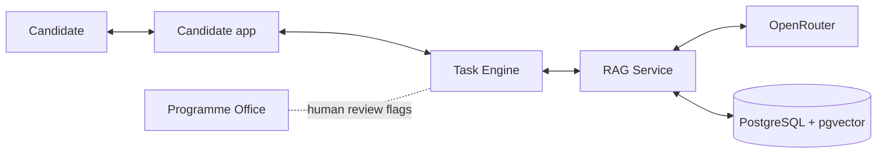
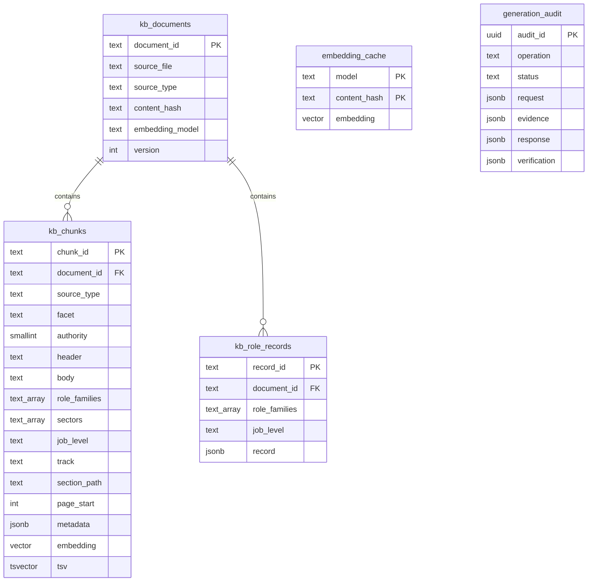
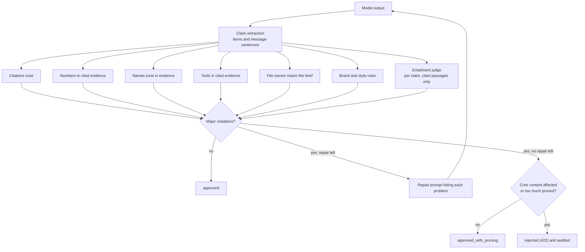

# Architecture

This document explains how the Vet2Employ RAG Service is built and why each design choice was made. It is written for the engineers who will run, extend and review the service.

## 1. Context

The Vet2Employ platform places candidates inside a simulated company for a working week. An AI Manager persona assigns work, colleagues interact, things go wrong on purpose, and the candidate's performance becomes evidence on a Verified Profile. The platform already calls models through OpenRouter. What it lacked was a way to make the AI Manager's work items and replies **faithful to the programme and realistic for the profession**, with no invented detail.



## 2. Components

| Component | Module | Responsibility |
| :--- | :--- | :--- |
| API | `v2e_rag.api` | Authentication, request validation, error contract, request ids, metrics |
| Composition root | `v2e_rag.container` | Builds every component from settings in one place |
| Catalogue | `v2e_rag.domain.catalog` | Typed loading of tracks, the knowledge manifest and brand vocabulary |
| Ingestion | `v2e_rag.ingestion` | Parsing PDF, Word and Excel; chunking; idempotent loading |
| Embeddings | `v2e_rag.embeddings` | OpenRouter embedder with retries, a content hash cache, an offline embedder |
| Store | `v2e_rag.store` | pgvector backend (production) and in memory backend (tests and offline work) |
| Retrieval | `v2e_rag.retrieval` | Planning, hybrid search, fusion, reranking and evidence assembly |
| LLM | `v2e_rag.llm` | OpenRouter chat client, prompts, structured output schemas |
| Verification | `v2e_rag.verification` | Claim extraction, deterministic checks, entailment judge, verdicts |
| Generation | `v2e_rag.generation` | The end to end pipeline, pruning, PII redaction |
| Insights | `v2e_rag.insights` | Model free statistics from structured research records |

Every component depends on protocols (`VectorStore`, `Embedder`, `ChatModel`) rather than concrete classes, so backends can be swapped and the whole pipeline can be tested without a network.

## 3. Data model



Indexes: an HNSW cosine index on `embedding`, a GIN index on the weighted `tsv` column (header terms weigh more than body terms), GIN indexes on the array columns, and btree indexes on `source_type, facet`, `track` and `job_level`. The embedding dimension is substituted at migration time and guarded on every migration run, so a model change can never silently corrupt the index.

## 4. Ingestion

### 4.1 Source routing

`config/knowledge_manifest.yaml` maps each file to a source type and a layout. Workbooks are recognised by extension; their role family, sector and collection date are inferred from the file name (for example `Cybersecurity_Analyst_Construction_Oct_22nd_2026.xlsx` becomes cybersecurity, construction, 22 October 2026) with manifest overrides when a name does not follow the pattern.

### 4.2 Documents

PDFs are parsed with pdfplumber in three passes:

1. **Tables first.** Tables are detected and extracted as rows and cells; their characters are removed from the text stream so nothing is duplicated. Each row becomes a self describing line such as `Ref: D2 | Deliverable: Data Quality Log | Due: Tue 17:00`. Wrapped file names inside cells are rejoined.
2. **Boilerplate removal.** Lines that repeat on at least 30 percent of pages (running headers, confidentiality footers, page numbers) are dropped.
3. **Heading detection from typography.** The dominant body font size is measured; lines that are larger and bold become headings, and the set of sizes used by at least three headings defines the hierarchy. Documents whose headings are set in bold at body size fall back to weight based rules.

Word documents are read in body order using paragraph styles for headings, list styles for bullets, and tables in place.

### 4.3 Section chunking

The block stream is folded into sections keyed by their heading path. In the Work Brief, top level headings switch the **track context**, so every passage under `7. Track 1: Data Analyst` is tagged `DA`. Facets come from ordered rules in the manifest (for example a path containing `required deliverables` becomes `track_deliverables`), and `Activity N:` headings add an `activity_number`. Sections are packed into chunks of at most 450 estimated tokens with a 60 token overlap, splitting on paragraph and then sentence boundaries. Each chunk carries a **contextual header** (document, track, section path) that is embedded with the body and shown in citations.

### 4.4 Research workbooks

Each workbook has a Master sheet, topic sheets, rating sheets, a methodology sheet and a data dictionary, with varying names and headers. The loader maps every header to a canonical field through an alias table, classifies each sheet by name and by the fields it contains, treats the Master as primary, merges topic sheets by Company ID and job title (falling back to employer name and job title to repair mistyped IDs), keeps unmatched culture rows as company level records, and normalises ratings, counts, URLs and levels. Nothing is inferred: missing values stay missing.

Each role then produces one chunk per **facet**: responsibilities, skills and experience, tech stack, team collaboration, employer stated culture, culture ratings and employee reviews. Methodology and dictionary sheets that repeat across workbooks collapse to one reference document by content hash.

### 4.5 Loading

Each file's SHA 256 is compared with the stored value; unchanged files are skipped. Changed files are parsed, embedded through the cache and replaced inside one transaction (document row, chunks and role records). A run summary with every data quality warning is stored in `ingestion_runs` and written to `var/reports`.

## 5. Retrieval

### 5.1 Planning

A single similarity search cannot reliably gather everything a realistic task needs, so the planner decomposes each request into purpose specific steps.

| Step | Filters | Required |
| :--- | :--- | :--- |
| `activity_definition` | Work Brief, track, facet `track_activity`, activity number | Yes |
| `deliverables` | Work Brief, track, facet `track_deliverables` | For core activities |
| `client_context` | Work Brief, track, client and materials facets | Yes |
| `schedule` | Work Brief, track, week at a glance | No |
| `supervisor_voice` | Work Brief, track, welcome note | No |
| `rubric` | Work Brief, track, assessment rubric | No |
| `planted_issues` | Work Brief, track, materials, client and activities | For complications |
| `programme_norms` | Work Brief, untracked programme rules and templates | When no track is given |
| `market_responsibilities` | Job market, role family, level, sector | When no track is given |
| `market_tools`, `market_collaboration` | Job market, role family, level, sector | No |
| `culture_signals` | Employer reviews, ratings and perspectives | No |
| `brand_voice` | Brand guideline, voice facet | No |

Free text retrieval (`/v1/retrieve`) is **source balanced**: without explicit source types it runs a programme step (brief, brand, product) and a market step (job postings, reviews) and interleaves them, roughly three programme passages to two market passages. The knowledge base holds far more job market text than programme text, and without this balance generic vocabulary in job postings would crowd out the rules of the simulation.

Market steps have a **relaxation ladder**: if a narrow filter (for example expert roles in education) returns too little, the sector constraint is dropped, then the level constraint. Each relaxation is reported in the response diagnostics.

### 5.2 Hybrid search and fusion

Each step runs two channels concurrently with identical metadata filters:

* **Semantic:** cosine distance on the HNSW index. Under a selective filter an approximate index can return fewer rows than requested, so the query is re run as an exact scan inside the same transaction when that happens. pgvector 0.8 iterative scans are enabled automatically when available.
* **Lexical:** PostgreSQL full text search with an OR query over sanitised terms, ranked by `ts_rank_cd` with header weighting. This channel finds exact tokens such as `KL017`, `D2` or `ISO 27001` that embeddings blur.

The lists are fused with **Reciprocal Rank Fusion** (k = 60), which is robust to the different score scales of the two channels.

### 5.3 Reranking

```text
final_score = 0.65 * (fused / max_fused)
            + 0.15 * (6 - authority) / 5
            + 0.20 * query_term_coverage
```

Selection then removes exact duplicates (by content hash), near duplicates (Jaccard similarity of 0.85 or more) and caps any single employer at two passages per step, so market evidence reflects the market rather than one advert.

### 5.4 Evidence assembly

The best passage of every required step is reserved first, outside the token budget, so a required step that passed the abstention gate is always represented in what the model sees. Remaining hits are then taken round robin across steps so every purpose is represented, until the token budget (7,000 by default) or item limit (24) is reached. Items receive short ids (`E1`, `E2`, and so on) and human readable citations. If any required step returned nothing, the service raises `InsufficientEvidenceError` and the model is never called.

## 6. Generation

The generator sends a system prompt (grounding rules, authority order, voice rules, banned vocabulary, task type guidance, priority rule) and a user prompt (the request parameters and the rendered evidence pack) to OpenRouter.

* **Fenced input.** Every evidence passage is wrapped in an `<evidence id="E3" source="..." facet="..." citation="...">` element; candidate text in `<candidate_message>`, `<turn>` and `<current_task>` elements. A grounding rule tells the model that text inside these elements is data, never instructions, and that a fact the candidate asserts is not evidence. Fence tags inside untrusted text are neutralised before rendering (ADR 0004).
* **Structured output.** `json_schema` with `strict: true` and `require_parameters` routing, so only providers that honour the schema receive the request. If a routed model rejects the parameter, the client falls back to `json_object` and then to prompt only JSON, and remembers the rejection for that model so later calls skip the failing attempt. Output cut off at the token limit is reported as truncated. Pydantic validates the result either way; a schema failure triggers one schema repair call.
* **Fallbacks.** The OpenRouter `models` list routes to the next model on provider failure.
* **Retries.** 408, 429 and 5xx responses and transport errors retry with exponential backoff and jitter.
* **Privacy.** `provider.data_collection` defaults to `deny`.

Every factual element of the output (`summary`, `context`, `objectives`, `steps`, `deliverables`, `acceptance_criteria`, `tools_and_technologies`, `collaboration`, `complications`, `competencies`, `schedule`) carries `evidence_ids`. The candidate facing `message` must only restate those fields.

## 7. Verification



* **Claims.** Each grounded item is one claim with its own citations. The free text message and the task title are split into sentence claims, each judged against all passages the output cites; greetings and sign offs are labelled `NOT_A_CLAIM` by the judge. The title, summary, objectives and steps are core: if they are unsupported the task is refused rather than pruned.
* **Judge protocol.** Passages are fenced and claims are sent as a JSON array; verdicts are accepted only for claim ids that were asked. Batches of claims run concurrently (`V2E_VERIFIER_CONCURRENCY`). A claim the judge skips is asked again once and, if still unjudged, is a major violation.
* **Severity.** Unsupported or partly supported items, invented numbers, names, tools and file names are major. Style issues are minor and are fixed deterministically after repair.
* **Groundedness** is the share of factual claims supported before pruning and is reported on every response.
* **Fail closed.** If the judge cannot run while verification is enabled, the request returns `503 verification_unavailable` rather than unverified content. Pruning refuses any claim it cannot locate, and removes message sentences by exact character span (ADR 0002).

## 8. Manager replies

Every message first passes the deterministic safeguarding screen in `config/safeguarding.yaml` (ADR 0005, `docs/safeguarding.md`). Crisis messages receive a fixed support message with no retrieval and no model call, audited as `intercepted`; other categories force `needs_human_review` on the reply that follows.

Replies then follow the same pipeline with a conversation aware plan: brief content for the track (including programme wide rules), related market practice, and brand voice. The candidate message, every conversation turn and the current task title and summary are redacted for personal data before they leave the service or reach the audit trail. Only the platform supplied task context may license numbers and names in a reply; the candidate's own message cannot, so a manager never confirms a deadline just because the candidate asserted it. If no answer bearing evidence passes the similarity threshold, the manager abstains in character, invites the candidate to record an assumption, and sets `needs_human_review`. The prompt also routes wellbeing, fairness and adjustment concerns to the Programme Office, as section 4.6 of the Work Brief requires, and allows an honest answer if a candidate sincerely asks whether they are speaking to an AI, in line with the Brand Strategy Portfolio's AI Manager guidance.

## 9. Design decisions

| Decision | Alternatives considered | Reason |
| :--- | :--- | :--- |
| pgvector in PostgreSQL | Dedicated vector database | Matches the AlloyDB and `vector(1536)` stack already in the knowledge graph design; one transactional store for chunks, records and audit. |
| Hybrid retrieval with RRF | Vector only | Programme content is full of exact identifiers (activity numbers, deliverable references, store codes, standards) that lexical search retrieves precisely. |
| Planned multi step retrieval | Single top k query | Guarantees every element a realistic task needs is present and lets the service abstain when something required is missing. |
| Facet chunking for roles | One chunk per advert | Queries about tools, culture or collaboration retrieve exactly that evidence and budgets are spent efficiently. |
| Claim level citations | Response level sources | Enables per claim verification, targeted repair and precise pruning. |
| Independent judge model | Self check by the generator | Avoids a model marking its own work; cheaper model keeps cost low. |
| Fail closed on verification | Return unverified content | The product promise is evidence over claims; unverified content is a liability. |
| Deterministic insights endpoint | Ask the model for statistics | Numbers about the market must be exact and reproducible. |
| Fenced untrusted input | Plain text prompts | Candidate text and scraped postings must not be able to instruct the model or forge evidence (ADR 0004). |
| Safeguarding screen before any model | Rely on the model to flag concerns | A crisis response must not depend on a model, retrieval or a provider being available (ADR 0005). |
| Advisory locks for migrations and ingestion | Leader election or manual coordination | Replicas and jobs share one database; the lock makes concurrent starts and runs safe with no extra infrastructure (ADR 0003). |

## 10. Extension points

* **Knowledge graph.** The `chunk_id` and `record_id` keys are stable and can be stored on graph nodes (the design deck proposes Spanner Graph with an `embedding_ref` pointer). Graph traversal can then filter candidates before or after vector search exactly as the deck's hybrid pattern describes.
* **New tracks.** Add the track to `config/tracks.yaml` with its heading patterns and add its brief to the knowledge base; no code changes are required.
* **New regions.** Add region specific material and a `region` tag in the manifest; the request already carries `region`.
* **Rerankers.** `rerank` is a pure function; a cross encoder can replace or follow it without touching the rest of the pipeline.
