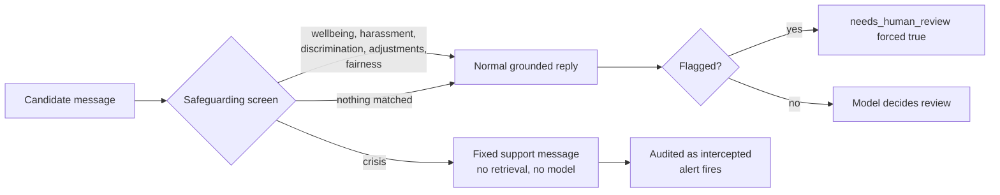

# Safeguarding

Vet2Employ candidates include veterans moving into civilian work. Some will be under pressure, and a few may disclose something serious to the AI Manager because it feels like a manager. The service must never be the only thing standing between that disclosure and a person who can help.

## How it works

Every message to `POST /v1/manager/reply` passes a deterministic screen before anything else happens. The rules live in `config/safeguarding.yaml`, which the Programme Office owns.



| Category | Default action | Typical signals |
| :--- | :--- | :--- |
| `crisis` | intercept | Suicidal thoughts, self harm, wanting to die |
| `wellbeing` | flag | Overwhelmed, cannot cope, burnt out, panic attacks, working through the night |
| `harassment` | flag | Bullying, threats, inappropriate comments |
| `discrimination` | flag | Discrimination or prejudice because of a protected characteristic |
| `reasonable_adjustments` | flag | Dyslexia, ADHD, disability, accessibility, extra time |
| `assessment_fairness` | flag | Unfair scoring, appeals, disputed feedback |

**Intercept** returns a fixed message, written by people, that steps outside the simulation, says the Programme Office will make contact, and lists urgent support (999, NHS 111 mental health option, Samaritans on 116 123). The verdict is `intercepted`, `reply.intent` is `escalate` and `reply.needs_human_review` is true. No model sees the message.

**Flag** lets the normal grounded reply through and forces `needs_human_review` to true with a review reason, even if the model decided otherwise. The screen only ever adds caution; it never removes a review the model requested.

The response always carries the screen result:

```json
"safeguarding": {"flagged": true, "categories": ["wellbeing"], "action": "flag"}
```

## What the platform must do

1. Show `reply.reply` to the candidate as usual, including the intercept message.
2. When `reply.needs_human_review` is true, create a Programme Office case with `review_reason` and `meta.audit_id`.
3. When `safeguarding.action` is `intercept`, treat the case as urgent. The `V2ESafeguardingIntercept` alert in `deploy/prometheus/alerts.yaml` pages on every intercept; make sure it reaches a named person during programme hours and has an out of hours route.
4. Pause automated task issuing for an intercepted candidate until a person has made contact.

## Before launch: Programme Office review

The shipped rules are a careful starting point, not an approved policy. Before launch the Programme Office should:

* review every pattern and the intercept wording, and confirm the support contacts against each service's own website;
* decide whether to add a veteran specific service, after confirming its current number;
* confirm the review route, who staffs it, and the response time for urgent cases;
* decide whether crisis messages should be intercepted (default) or flagged (`V2E_SAFEGUARDING_CRISIS_ACTION=flag`).

## Changing the rules

1. Edit `config/safeguarding.yaml`. Patterns are regular expressions matched case insensitively against the message with curly apostrophes normalised.
2. Add a case for the new wording to `test_safeguarding_screen` in `tests/unit/test_hardening.py`, including at least one everyday phrase that must not match (for example "this bug is killing me").
3. Run `make test`, then deploy. The file is read at start up.

False positives on flag categories cost a human a short review. False negatives can cost far more. When in doubt, flag.

## Limits

Pattern matching cannot understand every way a person might express distress, and it does not read earlier turns. It is a safety net under the model's own judgement (the manager prompt still asks the model to flag these concerns), not a replacement for human oversight of the programme.
