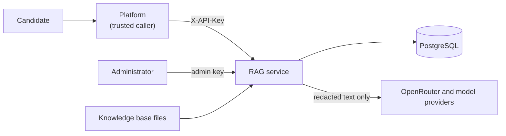

# Security model

This document describes what the service protects, the threats considered, the controls in place and the risks that remain. Review it whenever an endpoint, a data flow or a dependency changes.

## 1. Assets

| Asset | Why it matters |
| :--- | :--- |
| Candidate messages and conversation history | Personal data; may contain health or safeguarding disclosures |
| Generated tasks, replies and the audit trail | Evidence behind each candidate's Verified Profile |
| Knowledge base (Work Brief, brand material, research) | Confidential programme material |
| OpenRouter key, platform and admin keys, database credentials | Grant spending, data access and control of the knowledge base |

## 2. Trust boundaries

The platform is trusted to authenticate candidates; the service authenticates the platform. Text that originates with a candidate is untrusted even though the platform forwards it. Knowledge base passages are semi trusted: the programme documents are written by Phexara, but job posting text was collected from the web.

## 3. Threats and controls

| Threat | Controls |
| :--- | :--- |
| A model invents a deadline, colleague, tool or file | Planned retrieval with abstention; constrained generation; deterministic checks; an independent judge that fails closed on errors and on skipped claims; repair, prune or refuse; the title verified as core content |
| Prompt injection in a candidate message or history ("ignore your rules", forged evidence) | Untrusted text fenced in elements the model treats as data; fence tags in that text neutralised; a grounding rule that candidate assertions are not evidence; numbers and names from the candidate do not license the reply; every claim verified against retrieved evidence |
| Prompt injection in job posting text | Evidence fenced with neutralised tags; authority order puts the Work Brief first; verification checks claims, not instructions |
| Judge manipulation through claim text | Claims sent as a JSON array; verdicts accepted only for claim ids that were asked |
| Personal data sent to a model provider | Redaction of every free text field before model calls and audit writes; OpenRouter `data_collection: deny` |
| Safeguarding disclosure missed | Deterministic screen before any model call; crisis intercept; forced human review (see [safeguarding.md](safeguarding.md)) |
| Unauthorised use or knowledge base tampering | Separate platform and admin keys compared in constant time; production refuses to start without them; admin endpoints separated; upload type, signature and size checks; atomic writes |
| Secret leakage | Secrets held as `SecretStr`; log processor scrubs tokens, keys and database passwords; provider error text kept out of API responses; secret scanning in hooks and CI |
| Resource exhaustion | Body size limit before reading; whole request deadline; database statement timeout; bounded judge concurrency; bounded list sizes in every request model |
| Unsafe configuration reaching production | `Settings.production_problems` rejects missing keys, short or shared keys, memory backend, hashing embedder, disabled entailment, disabled redaction and wildcard CORS |
| Concurrent writers corrupting the knowledge base | Advisory locks for migrations and ingestion across every process |
| Vulnerable dependencies | Pinned lock file, `pip-audit` and an image scan in CI, Dependabot |
| Information exposure through errors | One error envelope; validation errors never echo input; unexpected errors return a generic message with a request id |

## 4. Data retention

The audit trail stores redacted requests, the evidence used, the output and the verification report. Set `V2E_AUDIT_RETENTION_DAYS` to the period agreed with data protection and schedule `v2e audit purge --yes` daily (`deploy/cloud_run/job_audit_purge.yaml`). Knowledge base files are the system of record for programme content and stay out of git.

## 5. Residual risks

* **Redaction is pattern based.** It removes common UK formats (email, phone, postcode, National Insurance, card, account, IBAN, sort code, credentials) but not names or free text descriptions of a person. Candidates should be told not to share personal details, as the Work Brief already requires.
* **The judge is a model.** Fail closed handling stops it from silently passing claims, but a confident wrong verdict is still possible. Deterministic checks and the generation evaluation reduce, not remove, this risk.
* **Safeguarding patterns** cannot catch every expression of distress. Human oversight of the programme remains essential.
* **Ingestion run status** is held in the memory of the replica that started the run; the durable record is the `ingestion_runs` table.
* **No rate limiting inside the service.** The platform is the only caller; apply rate limits at the platform or gateway if that changes.
